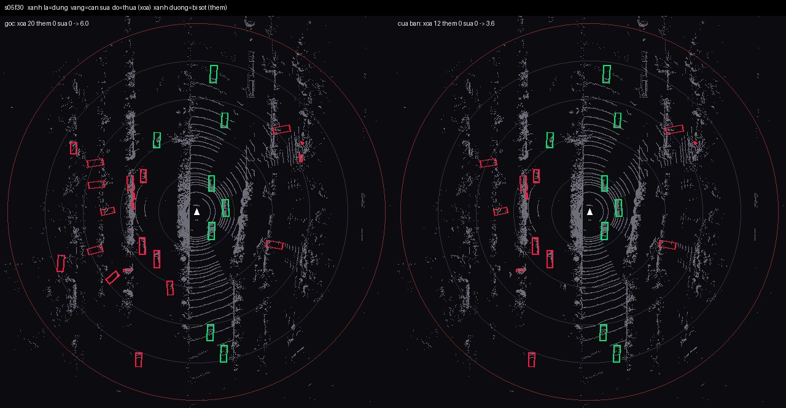

# Báo cáo Day 14 — Triệu Hoàng Hiếu — 2A202603294

- Mã học viên dùng với `--student`: `2A202603294`
- `seed_tag` trong `frames_A.txt`: `82ac3100fd`
- Công cụ hỗ trợ: Codex hỗ trợ chạy script, xem ảnh và soạn báo cáo. Các phần chưa kiểm chứng được ghi rõ, không coi pre-label là nhãn đã sửa.

## 1. Dự đoán trước sweep (bước 5b)

Ghi trước khi chạy sweep, dựa trên ảnh camera và BEV của `s01f27`, `s04f24`, `s05f30`. Giữ nguyên phần này sau khi có kết quả.

- Tham số dự đoán giảm công sửa nhiều nhất: tăng `score_thr` từ 0.1 lên khoảng 0.3–0.4. Thử thêm `min_points=5` để loại hộp rất thưa điểm, nhưng không giả định bộ lọc này luôn có lợi.
- Lý do: `s01f27` có nhiều hộp Car dọc dải cây và xe đạp dựng bên đường; `s05f30` cũng có nhiều hộp trên hàng cây. Ở `s04f24`, nhiều ô tô thật đã có hộp, trong khi người và người lái xe hai bánh tại giao lộ có thể bị sót. Tăng ngưỡng có thể giảm hộp thừa, nhưng cũng có thể làm mất vật thể thật.
- Tiêu chí đối chiếu: chi phí `0.3*xóa + 1.0*thêm + 0.5*sửa`. Vì thêm hộp tốn nhiều hơn xóa, không chọn cấu hình chỉ dựa vào số hộp ít đi. Chưa kết luận cấu hình tốt nhất khi chưa có nhãn tham chiếu.

## 2. Tập A: kiểm tra nhãn và tune

**Trạng thái: bản nháp AI hỗ trợ, cần học viên kiểm tra trước khi nộp.** Codex đã rà ảnh camera/BEV, sửa nhãn trên CVAT task 29 và lưu `ref_A.json` từ dữ liệu đã lưu của CVAT local. Có 37 hộp bị loại, thêm 5 hộp ở `s04f24`, đổi lớp và chỉnh kích thước một xe tải ở `s01f27`. Chưa xác nhận mọi hộp đáp ứng dung sai của guideline; các phần bị che vẫn cần người kiểm tra.

| Cấu hình | Xóa | Thêm | Sửa | Chi phí |
|---|---:|---:|---:|---:|
| Gốc | 37 | 5 | 1 | 16.6 |
| `best_config.json` | 16 | 6 | 1 | 11.3 |

- Đã chạy 15 cấu hình: `score_thr=0.1,0.2,0.3,0.4,0.5` kết hợp `min_points=0,5,10`.
- Tham số đã đổi: `score_thr` từ 0.1 lên 0.5. Giữ `min_points=0`: ở ngưỡng 0.5, cả ba mức min_points cùng chi phí 11.3, nên không thêm bộ lọc không đem lại lợi ích trên tập A.
- Leave-one-out (đầu ra script):

```text
s01f27: cấu hình chọn {'score_thr': '0.5', 'min_points': '0'} → 1.1 (tốt nhất có thể 1.1)
s04f24: cấu hình chọn {'score_thr': '0.5', 'min_points': '0'} → 6.6 (tốt nhất có thể 5.9)
s05f30: cấu hình chọn {'score_thr': '0.4', 'min_points': '0'} → 5.7 (tốt nhất có thể 3.6)
```

- Cấu hình chưa ổn định hoàn toàn: khi bỏ `s05f30`, hai frame còn lại chọn 0.4 thay vì 0.5. Chọn 0.5 vì chi phí tổng thấp nhất trong grid, nhưng cần kiểm tra B riêng. Ở `s04f24`, chi phí tăng từ 6.2 lên 6.6; không thể khẳng định mọi frame đều cải thiện.

## 3. Trước/sau (bước 8)



| Frame | Chi phí gốc | Chi phí tune |
|---|---:|---:|
| s01f27 | 4.4 | 1.1 |
| s04f24 | 6.2 | 6.6 |
| s05f30 | 6.0 | 3.6 |
| Tổng | 16.6 | 11.3 |

- Script báo giảm khoảng **32%** trên ba frame A, tính chính xác `(16.6 - 11.3) / 16.6 * 100 = 31.93%`.
- Dự đoán ở mục 1 đúng về hướng tăng score_thr, nhưng ngưỡng tốt nhất trong grid là 0.5 thay vì khoảng 0.3–0.4 dự đoán. Min_points không cải thiện tại ngưỡng được chọn.
- Hộp cần xóa giảm 37 → 16, nhưng hộp cần thêm tăng 5 → 6; hộp cần sửa vẫn là 1. Chi phí giảm chủ yếu nhờ bớt hộp thừa, không phải vì model phát hiện thêm vật thể thật.
- Các số này so với nhãn AI hỗ trợ hiện tại. Nếu người kiểm tra thay đổi nhãn A thì phải chạy lại sweep và compare; không coi 32% là kết quả đã được người gán nhãn xác nhận.

## 4. Tập B

Đã chạy cấu hình tune trên đủ 12 frame, tạo `pred_B.json` với 141 hộp. Codex đã rà ảnh tổng hợp 7 camera của từng frame và ảnh cận từng hộp; loại 47 hộp, thêm 15 hộp, thay lớp/hình học của 4 hộp. Bản hiện tại lưu ở CVAT task 30 và xuất lại thành `ref_B.json`, đủ 12 frame với tổng 109 hộp. Các hộp thêm/chỉnh đã được xem trên hình chiếu Top/Side/Front từ LiDAR; phần suy luận bị che và dung sai vẫn cần học viên xác nhận.

Số đo từ lệnh bước 9 trên bản nháp hiện tại:

| Xóa | Thêm | Sửa | Chi phí |
|---:|---:|---:|---:|
| 49 | 17 | 2 | 32.7 |

- Công thức: `0.3*49 + 1.0*17 + 0.5*2 = 32.7`.
- Số thao tác ghi trong nhật ký khác số ghép của script: khi đổi mạnh vị trí/kích thước một hộp, BEV IoU có thể dưới 0.3, nên script tính thành một hộp xóa và một hộp thêm thay vì một hộp sửa.
- Loại tốn công nhất: model nhận nhầm cây, biển báo, hàng rào hoặc xe đạp dựng thành Car/Cyclist; bỏ sót người lái xe hai bánh và xe buýt. Có hộp Car chỉ bao phần trước xe tải, cần đổi lớp và mở rộng hình học.
- Trường hợp cần kiểm tra tiếp được liệt kê cụ thể trong [`review_notes.json`](../../d14_2A202603294/review_notes.json), đặc biệt xe tải ở `s05f01`, xe buýt/van ở `s05f48`, người gần ngưỡng 50 m ở `s04f11` và các vật bị che ở `s02f19`.
- **Chưa nộp LMS; chưa coi bản nháp này là nhãn đã được học viên kiểm tra xong.** Sau khi học viên rà CVAT và Save, xuất lại ref_A/ref_B; nếu A đổi thì tune lại trước khi hoàn tất bài nộp.

## 5. Giới hạn

- Chỉ 3 frame tune nên cấu hình có thể overfit; cần đọc kết quả leave-one-out và kiểm tra tập B riêng.
- Model học trên KITTI, khác miền dữ liệu VF; không học trực tiếp Truck/Bus và có thể bỏ sót Pedestrian/Cyclist.
- Chi phí sửa là công thức quy ước, không phải thời gian sửa thực tế và không thể quy thành số giờ tiết kiệm.
- Nhãn do model tạo hoặc AI hỗ trợ vẫn cần người gán nhãn kiểm tra trước khi nộp, theo yêu cầu lab.
